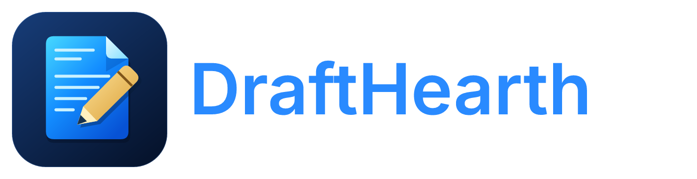

# DraftHearth

> **Product name:** DraftHearth (formerly Nisaba). Existing application IDs, settings directories, command names and repository URLs remain compatible.

<p align="center"></p>

**A fast, open-source word processor written in Rust, for documents, writing and design.** The
ribbon, styles, tables, track changes, references and mail merge; it reads and writes .docx, opens
.odt, .rtf, .html, .md and .txt, exports PDF, and can be driven by AI agents over MCP.

DraftHearth is a fork of [WordCraft](https://github.com/storytold/wordcraft) by the ArtCraft team and
community. It follows WordCraft closely and adds what a desktop built around local AI needs:

- **Scribe, a built-in local writing assistant**: improve, shorten, correct grammar, adjust tone or
  continue your writing. GGUF models run locally through the Enki daemon; document text stays on
  your computer. Suggestions become tracked changes you accept or reject.
- **A side-by-side VBA workspace**: edit modules, inspect the document model, place form controls,
  ask for coding help and review local code-completion suggestions. The optional .NET runtime
  executes supported macros against DraftHearth's command protocol.
- **A FreeBSD and KDE Plasma home**: packaging and defaults for a FreeBSD desktop distribution,
  alongside the Linux, macOS, Windows and web builds WordCraft already has.

DraftHearth keeps WordCraft's internal names (crates, commands, environment variables) so upstream
improvements merge cleanly; the product's name, app id and settings folders come from
[`crates/brand`](crates/brand/src/lib.rs).

## Build and run

```sh
cargo run --release -p wordcraft -- --sample          # the desktop app with the sample document
cargo run --release -p wordcraft-cli -- convert in.docx out.pdf
```

Packages install the programs as `nisaba` and `nisaba-cli`. Settings live in `~/.config/nisaba`
(macOS `~/Library/Application Support/Nisaba`, Windows `%APPDATA%\DraftHearth`), separate from an
installed WordCraft. **Help › Check for Updates** links to DraftHearth releases; automatic updates
are currently disabled while the upstream installer is adapted to DraftHearth’s package identity.

## Write with Scribe

1. Open **Review › Scribe**. Under **Settings**, download a catalog model or choose a compatible
   local GGUF file. Downloads require internet access; inference runs locally through the Enki
   daemon, which DraftHearth starts when needed.
2. Select text and choose **Improve**, **Shorten**, **Fix grammar** or **More formal**, or enter
   your own request. **Continue** can also use the text before the caret when nothing is selected.
3. Review the suggestion, then **Replace** or **Insert** it. Accept or reject the resulting edits
   through the Review tab.

Scribe refuses stale suggestions after document edits or switches, and prevents applying stopped
or incomplete results. Model downloads show progress, support cancellation and verify pinned file
hashes. The catalog includes Qwen, Gemma, Phi-4 mini and Llama 3.2; gated models require access
through Hugging Face. Model licenses apply separately.

Scribe currently works with selected text or nearby continuation context, with no document-wide
conversation history. Writing quality varies by model and task; review suggestions before accepting.
The assistant is available in desktop builds. See [the Scribe guide](docs/assistant.md) for setup,
limits and commands.

## Edit VBA and automate documents

Open **Developer › Code Editor** (**Alt+F11**) beside the live document. The workspace includes:

- A project explorer, syntax-colored code, `.bas`/`.cls` import and export, and embedded `.docm`
  module editing and saving.
- A document designer with selectable document nodes and an icon-based controls toolbox. Drag
  controls onto the page, or insert at the caret, using normal document editing and undo.
- Local coding chat with bounded document/module context, and **Suggest code** for completion.
  Review generated code before inserting it; code is never automatically executed.
- Optional **Check** and **Transpile** actions using the .NET SDK. Supported macros can run through
  the CLI, including filling existing body text controls and toggling check boxes.

The VBA helper requires the **.NET 8 or newer SDK**. Compatibility is a supported subset of Word's
VBA API, developed from public specifications and documented APIs. GUI macro execution, visual
UserForms, control events and full Word compatibility remain open. The runtime's allow-list is
defense in depth, not an operating-system sandbox; run only trusted macros. Native Microsoft Word
round-trip and execution acceptance remain unverified.

See [the VBA workspace guide](docs/vba-editor.md) and [runtime setup and compatibility](vba/README.md).

Contributor rules (never crash, no Microsoft assets, clean room, quality gates) are WordCraft's and
apply here unchanged: see [CLAUDE.md](CLAUDE.md) and [AGENTS.md](AGENTS.md). The detailed feature,
format and parity documentation is in [docs/](docs/).

## License and credits

MIT OR Apache-2.0, at your option. WordCraft is copyright (c) 2026 ArtCraft Team and the WordCraft
contributors; Nisaba's changes are copyright (c) 2026 Tom Blanchard. See [NOTICE](NOTICE) and
[ATTRIBUTION.md](ATTRIBUTION.md) for bundled material. DraftHearth is not made, sponsored or endorsed by
the ArtCraft Team, and contains none of the ArtCraft marks.

The DraftHearth icon is original artwork for this repository: a clay tablet with wedge-shaped marks and
a reed stylus, after DraftHearth, the Sumerian goddess of writing and patron of scribes.
